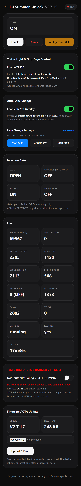

English | [简体中文](README_CN.md)
# EU Summon Unlock V2.7-LC (Single-CAN Mod)

### ESP32-S3 firmware for Tesla Smart Summon, TLSSC & `0x293` Auto Lane Change research

> 🔀 **Fork / Modification Notice**
>
> This repository is a single-CAN modification based on **EU Summon Unlock V2.6.0** by **X₿mod**, incorporating the `0x293` (`UI_autoLaneChangeEnable`) overlay logic adapted from [`06066060606060/P4can-universal-unlock`](https://github.com/06066060606060/P4can-universal-unlock).

> ⚠️ **Research / educational firmware only**
>
> This project interacts with a Tesla vehicle CAN bus. It is intended for controlled bench testing, code review, and research environments only.
>
> It sends signals directly to the controller. **Do not use this on public roads or in any situation where unsafe behavior could put people or property at risk.**
>
> You are responsible for your own testing, wiring, configuration, and compliance with local laws.

---

### ⚠️ DO NOT ACTIVATE TLSSC RESTORE ON NON-BANNED CARS (instant VIN ban risk outside China)

---

## 📋 What's New

### V2.7-LC (This Mod)
- **Added `0x293` Auto Lane Change Overlay** (ported from `P4can-universal-unlock` for single Chassis CAN): forces `UI_autoLaneChangeEnable = 1` (bits 24..25) with rolling counter and checksum recalculation while AP is active.
- **Independent Auto Lane Change Toggle**: dedicated web UI switch (`/api/lc-enable`, `/api/lc-disable`) persisted to NVS.
- **Live `0x293` Telemetry**: added `rx659`, `tx659`, and `raw293` status indicators to the dashboard and `/api/stats`, plus non-blocking 2-second `[STAT]` serial logging.
- **Updated TLSSC Gate**: `0x3FD` mux0 injection (bits 38 & 39) now triggers when AP is active (`gateAPActive`) or Force Mode is enabled.
- **Hardware Pinout**: remapped default TWAI pins for **Waveshare ESP32-S3-RS485-CAN** (`TX = 15`, `RX = 16`).
- **UI Fix**: fixed minor CSS selector typo and reorganized Auto Lane Change settings into a dedicated card.

### V2.6.0 (Upstream)
- Includes an updated summon logic for much better stability (500 ms periodic echo).

---

## 🇪🇺 Features

- Bypass **R79 EU restriction** in AP (`0x3FD` mux1).
- Expand Summon range to **±85 m**.
- Expanded lateral acceleration limits.
- **Auto Lane Change (`0x293` overlay)** on single Chassis CAN:
  - Note: Without a second CAN bus (Party CAN nag-killer), standard hands-on steering wheel torque confirmation is still required during lane changes.
- Blindspot aggressiveness settings during lane change (`STANDARD` / `AGGRESSIVE` / `MAD_MAX` on `0x3F8`).
- Toggle to activate **TLSSC** (Traffic Light & Stop Sign Control) & **Continue on Green with CIPV** (`0x3FD` mux0 bits 38, 39).
- **TLSSC Restore** (`0x331`) for already-banned vehicles only.
- Built-in Web OTA firmware update support.

---

## ⚙️ How It Works

Each feature is gated independently to avoid unintended injection during normal manual driving:

```text
Summon / R79 (0x3FD mux1) : (Summon enabled && (Parked || Summoning)) || ForceMode
TLSSC        (0x3FD mux0) : TLSSC enabled && (APActive || ForceMode)
Lane Change  (0x293)      : LaneChange enabled && APActive && stock raw != 1
Blindspot    (0x3F8)      : APActive && stock value != selected mode
```

---

## ✅ Compatibility

| Item | Version / Status |
|---|---|
| AP Injection | Does not work before **2026.20** |
| Upstream confirmed | **2026.26.1** (Model Y HW4) |
| V2.7-LC tested on | **2021 Model 3 SR+ (Intel / HW3)** — Chassis CAN (X179 pins 13 & 14) |

---

## 🔧 Hardware

### Required Hardware

- **ESP32 / ESP32-S3** — any variant with a TWAI/CAN peripheral (e.g., **Waveshare ESP32-S3-RS485-CAN** or M5Stack Atom S3 Lite + CAN Base).
- **CAN transceiver** — onboard or external (e.g., SN65HVD230 / MCP2562 / TJA1051).
- Wired to the **Chassis CAN bus** (500 kbps):
  - Typically at the **X179 connector, pins 13 & 14**.

### Pin Defaults — Waveshare ESP32-S3-RS485-CAN

```cpp
#define CAN_TX_PIN  15
#define CAN_RX_PIN  16
```

*(For M5Stack Atom S3 Lite with CAN Base, change these back to `TX = 5`, `RX = 6`.)*

---

## 🌐 Wi-Fi Dashboard

After boot, the ESP32 creates a Wi-Fi access point.

| Parameter | Value |
|---|---|
| **SSID** | `Summon-XXYY` — last 2 bytes of MAC |
| **Password** | `summon1234` |
| **Dashboard** | `http://192.168.4.1` |

### Dashboard Panels

- **State**: Master enable/disable toggle (`Summon`) and AP Force Mode indicator, persisted to **NVS**.
- **Traffic Light & Stop Sign Control**: Independent toggle for `0x3FD` mux0 (bits 38 & 39).
- **Auto Lane Change**: Independent toggle for `0x293` overlay and `0x3F8` blindspot aggressiveness (`STANDARD` / `AGGRESSIVE` / `MAD_MAX`).
- **Injection Gate**: Real-time state of `Gate`, `APActive`, `Parked`, and `Summoning`.
- **Live**: Per-ID RX counters (`280`, `390`, `921`, `1016`, `659`, `1021 mux1`), `0x293` TX counter (`tx659`) and raw value (`raw293`), total `TX ok / fail`, CAN bus state, and uptime.
- **OTA Update**: Upload compiled `.bin` files directly from the browser.

---

## 🔌 REST API

```text
GET  /api/stats          → JSON snapshot of all state and counters
POST /api/enable         → Enable Summon injection (persisted to NVS)
POST /api/disable        → Disable Summon injection (persisted to NVS)
POST /api/tlssc-enable   → Enable TLSSC (0x3FD mux0)
POST /api/tlssc-disable  → Disable TLSSC
POST /api/lc-enable      → Enable Auto Lane Change (0x293)
POST /api/lc-disable     → Disable Auto Lane Change
POST /api/blindspot?mode=0|1|2 → Set 0x3F8 mode (0=STANDARD, 1=AGGRESSIVE, 2=MAD_MAX)
POST /api/forcemode      → Toggle Force Mode
POST /update             → Upload .bin firmware for OTA update
```

---

## 📡 CAN Frames Monitored & Modified

| ID (dec) | ID (hex) | Signal | Direction / Role |
|---:|---:|---|---|
| 280 | `0x118` | `DI_systemStatus` | RX — Gear (Parked), ACA |
| 390 | `0x186` | `DIF_torqueStatus` | RX — Gear backup (Parked) |
| 659 | `0x293` | `UI_chassisControl` | **RX / TX** — Auto Lane Change (`UI_autoLaneChangeEnable`, bits 24..25) |
| 817 | `0x331` | `DAS_autopilotConfig` | **RX / TX** — TLSSC Restore (off by default, banned cars only) |
| 921 | `0x399` | `DAS_autopilotStatus` | RX — APActive (`status 3..6`) |
| 1016 | `0x3F8` | `UI_driverAssistControl` | **RX / TX** — SPR (Summon) & `UI_ulcBlindSpotConfig` (bits 52..53) |
| 1021 | `0x3FD` | `UI_autopilotControl` | **RX / TX** — Summon/R79 (mux 1) & TLSSC (mux 0) |

---

## 📦 Build Firmware for OTA

For the first flash via Arduino IDE (or PlatformIO):
- Partition Scheme: `Default 4MB with spiffs (1.2MB APP / 1.5MB SPIFFS)` (or any OTA-capable scheme matching your board's flash size).

1. Open the sketch in Arduino IDE / VS Code.
2. Select **Sketch → Export Compiled Binary**.
3. Locate the generated `.bin` file in the build output folder.
4. Connect to the ESP32 Wi-Fi AP and open `http://192.168.4.1`.
5. Upload the `.bin` file under **Firmware / OTA Update**.

---

## 🔀 Upstream & Multi-CAN Variants

- **P4-CAN Universal Unlock (3-CAN / ESP32-P4)**: https://github.com/06066060606060/P4can-universal-unlock
- **Nag-killer & EU-Summon-Unlock (T-2CAN)**: https://github.com/06066060606060/T2CAN-Nag-killer-EU-unlock
- **Advanced EAP & EU-Summon-Unlock (T-2CAN)**: https://github.com/06066060606060/Advanced-eap-eu-unlock

---

## ⚠️ Safety Notes

- This firmware only overlays UI/AP configuration frames (`0x3FD`, `0x3F8`, `0x293`, and optionally `0x331` when explicitly confirmed by the user).
- It does **not** alter steering actuators, braking, powertrain torque, or speed limits.
- Feature gates prevent active injection during normal manual driving.
- Every toggle can be disabled via the web dashboard at any time and is persisted to NVS.
- **Use at your own risk. This project is for research and educational purposes only.**

---

## 💬 Upstream Community & Support

- **Discord**: https://discord.gg/euPbYG8Npc

### ☕ Support the Original Author (X₿mod)

[](https://tesla-mods.fkey.id/) [](https://www.paypal.com/donate/?hosted_button_id=Q2YMMMJYTAPJE)
<a href="https://www.buymeacoffee.com/xbmod" target="_blank"></a>

---

## 🙏 Credits & Collaborators

- **X₿mod** — Creator of the original **EU Summon Unlock** project.
- **06066060606060** — Author of **P4-CAN Universal Unlock** (`0x293` overlay & checksum reference).
- **Gemini (Google AI)** — Key collaborator on this V2.7-LC adaptation (CAN bus analysis, `0x293` porting, TLSSC gate debugging, and dashboard refactoring).
- **Ev Open Can Tools** — Inspiration & community research.
- **Espressif Systems** — ESP32 TWAI driver.

---

## 📄 License

Licensed under the **GNU General Public License v3.0 or later (GPL-3.0-or-later)** to remain compliant with upstream components from `P4can-universal-unlock`.

---

## 📸 Dashboard

<!-- 建议替换为你的 V2.7-LC 网页截图 -->

