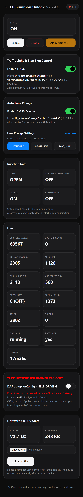

[English](README.md) | 简体中文

# EU Summon Unlock V2.7-LC（单路 CAN 修改版）

### 基于 ESP32-S3 的特斯拉智能召唤、TLSSC（红绿灯控制）与 `0x293` 自动变道研究固件

> 🔀 **衍生修改说明**
>
> 本项目是基于 **X₿mod** 原作 **EU Summon Unlock V2.6.0** 的单路 CAN 修改版，并参考移植了 [`06066060606060/P4can-universal-unlock`](https://github.com/06066060606060/P4can-universal-unlock) 中的 `0x293`（`UI_autoLaneChangeEnable`）覆写与校验和逻辑。

> ⚠️ **仅供研究与学习使用**
>
> 本固件会直接与特斯拉车辆 CAN 总线进行交互，仅适用于受控环境下的台架测试、代码审查与技术研究。
>
> 固件会直接向车载控制器发送报文。**请勿在公共道路上使用，或用于任何可能危及人身与财产安全的场景。**
>
> 使用者需自行承担测试、接线、配置以及遵守当地法律法规的全部责任。

---

### ⚠️ 严禁在未被封禁的车辆上开启 `TLSSC RESTORE`（海外服务器车辆有极高永久封禁 VIN 风险）

---

## 📋 更新日志

### V2.7-LC（本修改版）
- **新增 `0x293` 自动变道覆写**（移植自 `P4can-universal-unlock`，适配单路底盘 CAN）：在 AP 激活时，自动将 `UI_autoLaneChangeEnable`（bits 24..25）置为 `1`，并递增滚动计数器与重算校验和。
- **独立自动变道网页开关**：新增独立控制开关（`/api/lc-enable`、`/api/lc-disable`），状态持久化保存在 NVS 中。
- **新增 `0x293` 实时诊断遥测**：仪表盘与 `/api/stats` 新增 `rx659`、`tx659`、`raw293` 实时状态，并加入不阻塞 CAN 的 2 秒定时 `[STAT]` 串口调试输出。
- **优化 TLSSC 门控逻辑**：`0x3FD` mux0（bit 38、39）注入条件更新为 AP 激活（`gateAPActive`）或强制模式（`ForceMode`）开启时触发。
- **默认引脚适配**：默认 TWAI 引脚已改为适配 **微雪 Waveshare ESP32-S3-RS485-CAN**（`TX = 15`、`RX = 16`）。
- **网页界面优化**：修复原版 CSS 拼写错误，将自动变道与盲区激进程度合并为独立设置卡片。

### V2.6.0（上游原版）
- 更新召唤注入逻辑（500 ms 周期保活重发），大幅提升稳定性。

---

## 🇪🇺 功能特性

- 解除 AP 模式下的 **欧洲 UNECE R79 法规限制**（`0x3FD` mux1）。
- 扩展智能召唤有效距离至 **±85 m**。
- 放宽横向加速度限制。
- **单路底盘 CAN 实现打灯自动变道（`0x293` 覆写）**：
  - *说明*：由于单路底盘 CAN 未接入动力 CAN（Party CAN）模拟方向盘握持力矩，打灯变道时仍需按原车逻辑轻扶/轻摇方向盘完成握持确认。
- 支持调节变道盲区激进程度（`STANDARD` / `AGGRESSIVE` / `MAD_MAX`，对应 `0x3F8`）。
- 独立开关启用 **TLSSC（红绿灯与停车标志控制）** 及 **跟随前车绿灯通行（Continue on Green with CIPV）**（`0x3FD` mux0 bit 38、39）。
- **TLSSC Restore**（`0x331`）：**仅限已被封禁的车辆应急恢复使用**。
- 内置网页端 **OTA 固件无线升级**。

---

## ⚙️ 工作原理与门控条件

各项功能均设有独立门控，避免在正常手动驾驶期间产生不必要的总线注入：

```text
召唤 / R79   (0x3FD mux1) : (Summon 开启 && (驻车 Parked || 召唤中 Summoning)) || ForceMode
红绿灯 TLSSC (0x3FD mux0) : TLSSC 开启 && (AP 激活 || ForceMode)
自动变道     (0x293)      : LaneChange 开启 && AP 激活 && 原车原始值 != 1
盲区策略     (0x3F8)      : AP 激活 && 原车当前值 != 选定模式
```

---

## ✅ 兼容性说明

| 项目 | 版本 / 状态 |
|---|---|
| AP 注入要求 | 不支持 **2026.20** 之前的车机版本 |
| 上游实测通过 | **2026.26.1**（Model Y HW4） |
| V2.7-LC 实测通过 | **2021 款 Model 3 标续（Intel / HW3，右舵）** — 底盘 CAN（X179 针脚 13 & 14） |
| 舵向与车型适配 | **同时兼容左舵（LHD）与右舵（RHD）标准款 Model 3 / Model Y**（不适用于中国特供版 **Model Y L**，其总线拓扑映射不同） |

> 💡 **地区与固件提示**：中国区车机固件（CN 分支）在红绿灯识别地图依赖及法规策略上与海外版存在差异，具体生效功能可能随车机版本表现不同。

---

## 🔧 硬件要求与接线

### 所需硬件

- **ESP32 / ESP32-S3 开发板** — 任意带内置 TWAI/CAN 控制器的型号（如 **微雪 Waveshare ESP32-S3-RS485-CAN**，或 M5Stack Atom S3 Lite + CAN Base）。
- **CAN 收发器** — 板载或外接（如 SN65HVD230 / MCP2562 / TJA1051）。
- 并联接入车辆 **底盘 CAN 总线（Chassis CAN，500 kbps）**：
  - 2021 款及之后车型通常位于 **X179 接口的 13 号与 14 号针脚**（位于副驾驶侧 A 柱下方饰板内：左舵车在右侧，右舵车在左侧；更早的 2019–2020 款一般位于后排出风口下方）。

### 默认引脚配置 — Waveshare ESP32-S3-RS485-CAN

```cpp
#define CAN_TX_PIN  15
#define CAN_RX_PIN  16
```

*(如使用 M5Stack Atom S3 Lite + CAN Base，请在 `src/summon_unlock.ino` 顶部将引脚改回 `TX = 5`、`RX = 6`。)*

---

## 🌐 Wi-Fi 网页仪表盘

上电启动后，ESP32 会自动建立一个本地 Wi-Fi 热点：

| 参数 | 默认值 |
|---|---|
| **Wi-Fi 名称（SSID）** | `Summon-XXYY`（末尾为 MAC 地址后两字节） |
| **连接密码** | `summon1234` |
| **管理后台地址** | `http://192.168.4.1` |

### 面板功能说明

- **State（主状态）**：召唤解锁总开关与 AP 强制注入模式指示，掉电自动保存至 **NVS**。
- **Traffic Light & Stop Sign Control**：独立控制 `0x3FD` mux0（bit 38、39）红绿灯控制开关。
- **Auto Lane Change**：独立控制 `0x293` 自动变道覆写开关，以及 `0x3F8` 变道激进程度（`STANDARD` / `AGGRESSIVE` / `MAD_MAX`）。
- **Injection Gate（门控状态）**：实时显示 `Gate`、`APActive`、`Parked`、`Summoning` 状态。
- **Live（实时数据）**：实时显示各关键帧接收计数（`280`、`390`、`921`、`1016`、`659`、`1021 mux1`）、`0x293` 注入次数（`tx659`）与原车原始值（`raw293`）、总发送成功/失败次数、CAN 总线状态及运行时长。
- **Firmware / OTA Update**：直接通过浏览器上传编译好的 `.bin` 固件包进行无线更新。

---

## 🔌 REST API 接口

```text
GET  /api/stats                → 获取所有状态与计数器的 JSON 快照
POST /api/enable               → 开启 Summon 注入（保存至 NVS）
POST /api/disable              → 关闭 Summon 注入（保存至 NVS）
POST /api/tlssc-enable         → 开启 TLSSC（0x3FD mux0）
POST /api/tlssc-disable        → 关闭 TLSSC
POST /api/lc-enable            → 开启自动变道覆写（0x293）
POST /api/lc-disable           → 关闭自动变道覆写
POST /api/blindspot?mode=0|1|2 → 设置 0x3F8 变道策略（0=标准, 1=激进, 2=狂暴）
POST /api/forcemode            → 切换 Force Mode 状态
POST /update                   → 上传 .bin 固件进行 OTA 升级
```

---

## 📡 监听与修改的 CAN 报文清单

| ID（十进制） | ID（十六进制） | 信号名称 | 方向与用途 |
|---:|---:|---|---|
| 280 | `0x118` | `DI_systemStatus` | RX — 挡位（P 挡判断）、ACA 状态 |
| 390 | `0x186` | `DIF_torqueStatus` | RX — 备用挡位信号（P 挡判断） |
| 659 | `0x293` | `UI_chassisControl` | **RX / TX** — 自动变道开关（`UI_autoLaneChangeEnable`，bits 24..25） |
| 817 | `0x331` | `DAS_autopilotConfig` | **RX / TX** — TLSSC Restore（默认关闭，仅限已封禁车辆） |
| 921 | `0x399` | `DAS_autopilotStatus` | RX — AP 激活状态（`status 3..6`） |
| 1016 | `0x3F8` | `UI_driverAssistControl` | **RX / TX** — 召唤指令（SPR）与变道盲区配置（bits 52..53） |
| 1021 | `0x3FD` | `UI_autopilotControl` | **RX / TX** — 召唤/解除 R79（mux 1）与 TLSSC（mux 0） |

---

## 📦 编译与烧录方式

### 方式一：VS Code + PlatformIO（推荐）
本仓库根目录已包含 `platformio.ini` 与 `src/` 目录结构：
1. 使用 VS Code（已安装 PlatformIO 插件）打开项目根目录。
2. 首次刷机：通过 USB 连接开发板，点击底部状态栏 **Upload（向右箭头）** 直接烧录完整固件。
3. 导出 OTA 固件：点击 **Build（对勾）** 编译完成后，在 `.pio/build/<开发板名>/` 目录下找到 `firmware.bin`，通过网页后台 `http://192.168.4.1` 上传升级。

### 方式二：Arduino IDE
1. 在本地新建名为 `summon_unlock` 的文件夹，将本仓库 `src/` 中的 `summon_unlock.ino` 和 `index_html.h` 放入其中。
2. 分区方案（Partition Scheme）选择支持 OTA 的配置（如 `Default 4MB with spiffs (1.2MB APP/1.5MB SPIFFS)` 或匹配开发板 Flash 容量的方案）。
3. 首次烧录请通过 USB 上传；后续可通过 **项目 → 导出已编译的二进制文件** 生成 `.bin` 进行网页 OTA 升级。

> ℹ️ 如果本仓库右侧 **Releases** 页面已提供预编译的 `.bin` 文件，请注意核对说明中的芯片型号与默认 CAN 引脚（`ESP32-S3`，`TX=15 / RX=16`），该 `.bin` 仅适用于已刷过底层分区的设备进行网页 OTA 升级。

---

## 🔀 上游与多路 CAN 衍生项目

- **P4-CAN Universal Unlock（三路 CAN / ESP32-P4）**：https://github.com/06066060606060/P4can-universal-unlock
- **Nag-killer & EU-Summon-Unlock（T-2CAN 双路）**：https://github.com/06066060606060/T2CAN-Nag-killer-EU-unlock
- **Advanced EAP & EU-Summon-Unlock（T-2CAN 双路）**：https://github.com/06066060606060/Advanced-eap-eu-unlock

---

## ⚠️ 安全声明

- 本固件仅对 UI/辅助驾驶配置帧进行覆写（`0x3FD`、`0x3F8`、`0x293`，以及仅在用户二次确认开启后的 `0x331`）。
- 固件**不修改**转向执行器、制动系统、动力输出扭矩或车速限制相关报文。
- 内置门控机制避免在正常人工驾驶时触发不必要的注入；所有功能均可在网页仪表盘随时关闭并实时写入 NVS。
- **使用风险自负。本项目仅用于技术研究与学习交流，严禁在公共道路上使用。**

---

## 💬 上游社区与支持

- **Discord 社区**：https://discord.gg/euPbYG8Npc

### ☕ 赞助原作者（X₿mod）

[](https://tesla-mods.fkey.id/) [](https://www.paypal.com/donate/?hosted_button_id=Q2YMMMJYTAPJE)
<a href="https://www.buymeacoffee.com/xbmod" target="_blank"></a>

---

## 🙏 致谢与协作者

- **X₿mod** — 原版 **EU Summon Unlock** 项目作者。
- **06066060606060** — **P4-CAN Universal Unlock** 作者（提供 `0x293` 覆写与校验和逻辑参考）。
- **Gemini (Google AI)** — V2.7-LC 单路修改版核心协作者（CAN 总线信号分析、`0x293` 移植、TLSSC 门控调试与网页仪表盘重构）。
- **Ev Open Can Tools** — 开源灵感与社区研究。
- **Espressif Systems** — ESP32 TWAI 底层驱动。

---

## 📄 开源协议

本项目遵循 **GNU General Public License v3.0 或更新版本（GPL-3.0-or-later）** 开源，以符合上游 `P4can-universal-unlock` 项目的协议要求。

---

## 📸 网页仪表盘预览

